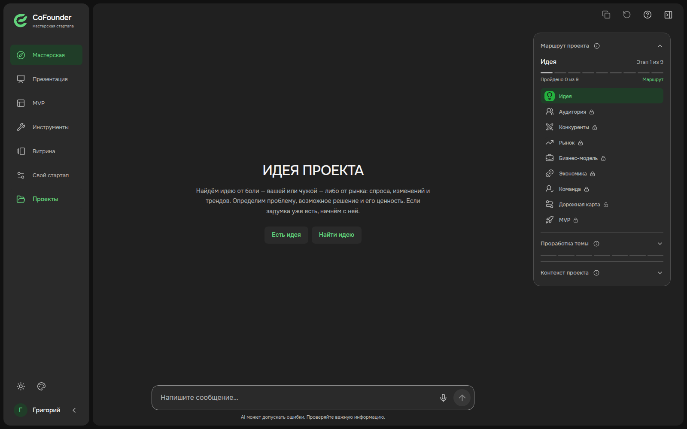
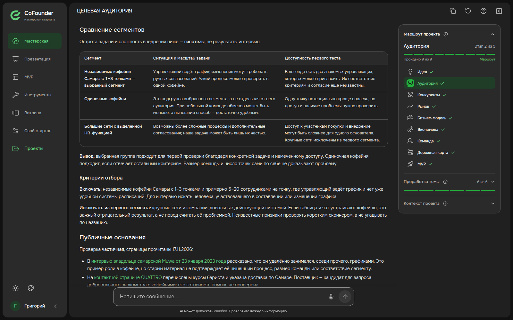
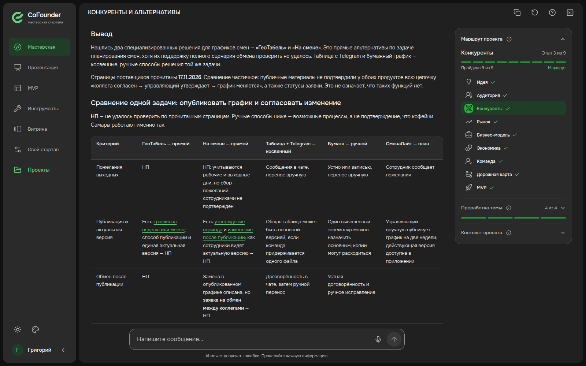
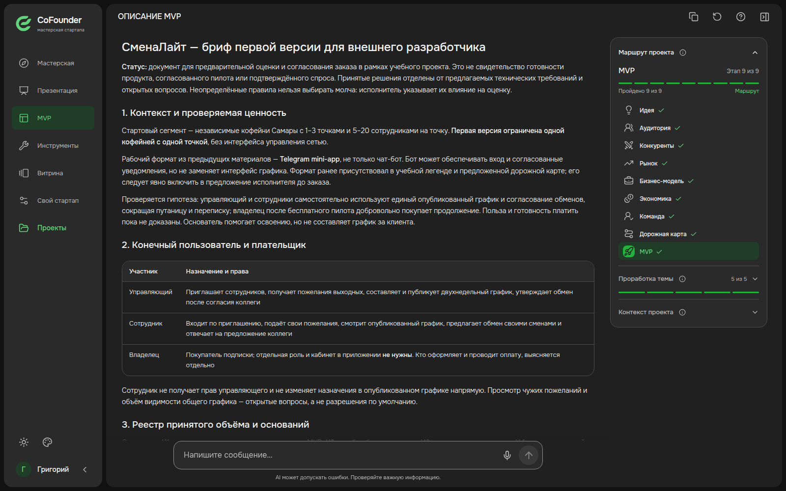
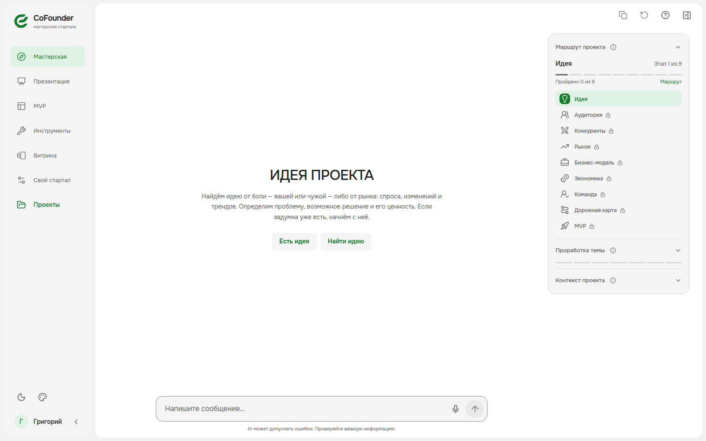
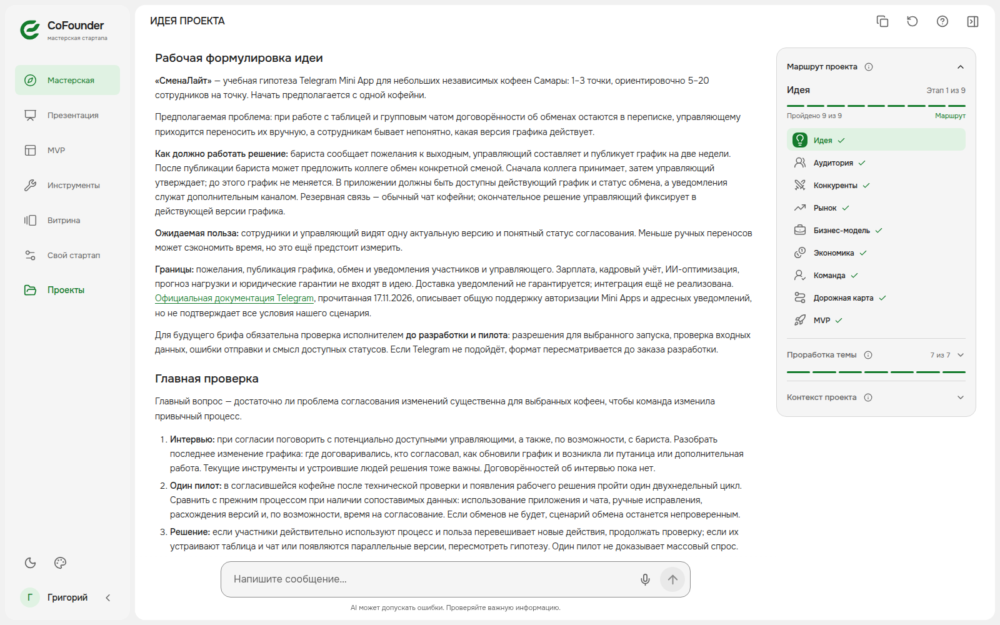

# CoFounder — от идеи к брифу

**Исследовательский прототип Григория Говорова.** Самостоятельная реализация по итогам изучения существующего CoFounder: интерфейс, AI-диалог, работа с публичными источниками и сохранение контекста проекта.

Бот помогает пройти от формулировки идеи до подробного брифа для внешней разработки. Ниже — реальные экраны текущего локального приложения, снятые 17 ноября 2026 года.

**[Презентация · PDF, 17 слайдов](docs/presentation/CoFounder-Govorov-2026-11-17.pdf)** · [Все 9 экранов с пояснениями](docs/screenshots/README.md) · [Архитектура](docs/architecture.md)


*«СменаЛайт» — учебный проект про согласование смен в кофейне. На экране сохранён настоящий ответ AI; спрос и коммерческий эффект не подтверждены.*

## Интерфейс

Основной показ — в тёмной теме. Светлая тема сохранена ниже для сравнения.

<table>
<tr>
<td width="50%"><strong>Начало работы</strong><br>Своя идея или поиск идеи.<br><a href="docs/screenshots/01-new-project.png"></a></td>
<td width="50%"><strong>Аудитория</strong><br>Сравнение сегментов и основания выбора.<br><a href="docs/screenshots/03-smenalight-audience.png"></a></td>
</tr>
<tr>
<td><strong>Конкуренты · тёмная тема</strong><br>Публичные источники и границы сравнения.<br><a href="docs/screenshots/04-smenalight-competitors-dark.png"></a></td>
<td><strong>Бриф для разработки</strong><br>Контекст, роли, сценарии и правила.<br><a href="docs/screenshots/05-smenalight-brief.png"></a></td>
</tr>
</table>

[Материалы проекта](docs/screenshots/README.md#материалы-проекта) · [Мобильный интерфейс](docs/screenshots/README.md#интерфейс-на-телефоне). Каждый снимок можно открыть в исходном разрешении.

<details>
<summary>Светлая тема — начало работы и идея проекта</summary>

<table><tr>
<td width="50%"><a href="docs/screenshots/08-new-project-light.png"></a></td>
<td width="50%"><a href="docs/screenshots/09-smenalight-idea-light.png"></a></td>
</tr></table>

</details>

## Что реализовано

- Чат как основное рабочее пространство: варианты ответа, голосовой ввод с редактированием, действия с сообщениями и перезапуск темы с подтверждением.
- Девять этапов: идея → аудитория → конкуренты → рынок → бизнес-модель → экономика → команда → дорожная карта → описание MVP. Панель показывает маршрут, покрытие критериев и общий контекст.
- Поиск публичных источников и серверное чтение страниц перед ответом. Отдельная AI-оценка процесса и результата; происхождение сведений и числовых допущений сохраняется.
- Расчёты рынка и экономики, сборка материалов проекта, подробный бриф для внешнего разработчика, JSON-экспорт и импорт проектов.
- Собственная библиотека компонентов, две темы, пять палитр и адаптивная компоновка.

## Устройство

| Часть | Реализация |
|---|---|
| Интерфейс | React, TypeScript, Vite; общие компоненты и дизайн-токены |
| Сервер | Node.js 24.18+, Express, Zod; статусы и ответ через SSE |
| AI | OpenAI Responses API; Luna — планирование и короткие проверки, Terra — ответ и отдельная оценка |
| Данные | Проекты и переписка — localStorage; журнал запросов и расходов — SQLite на сервере |
| Проверки | Vitest и Playwright; [решения по архитектуре](docs/adr/) и [дизайн-система](docs/design-system/) |

## Локальный запуск

Нужны Node.js 24.18+ и npm 11. Используйте обычный каталог без скрытых родительских папок:

```sh
npm ci
cp -n .env.example .env
npm run dev
```

Открыть http://localhost:3000. Без ключа и с `AI_BUDGET_USD=0` платные вызовы отключены; доступны локальные проекты, встроенный подготовленный пример и экспорт. Встроенный пример синтетический и отличается от «СменаЛайт» на скриншотах. Рабочие настройки AI задаёт владелец локально; ключ доступен только серверу.

```sh
OPENAI_API_KEY='' AI_BUDGET_USD=0 npm run build
OPENAI_API_KEY='' AI_BUDGET_USD=0 npm run check
```

Браузерные сценарии находятся в `tests/e2e`; их запускают на отдельном тестовом origin с нулевым бюджетом. Проекты между браузерами переносятся через JSON-экспорт.

## Статус прототипа

Это исследовательская реализация и отобранный снимок кода от 17 ноября 2026 года. Скриншоты показывают существующий интерфейс и сохранённые учебные результаты; они не доказывают подтверждённый спрос или готовность к коммерческой эксплуатации. Проработка критериев и отметки маршрута не являются прогнозом успеха бизнеса.

В «СменаЛайт» сохранены результаты отдельных проходов: рынок → бриф 16 ноября на Sol/Luna и первые три темы 17 ноября на Terra/Luna. Один непрерывный проход всех девяти этапов в текущей конфигурации не принимался. Оценщик требует калибровки. [Контекст и происхождение снимков](docs/screenshots/README.md#происхождение-и-границы).

В репозитории — исходники, тесты, документация, отобранные скриншоты и PDF. Секреты, рабочие JSON-проекты, финансовый журнал, переписка с рекрутером и сырые исследовательские записи остаются вне поставки.
