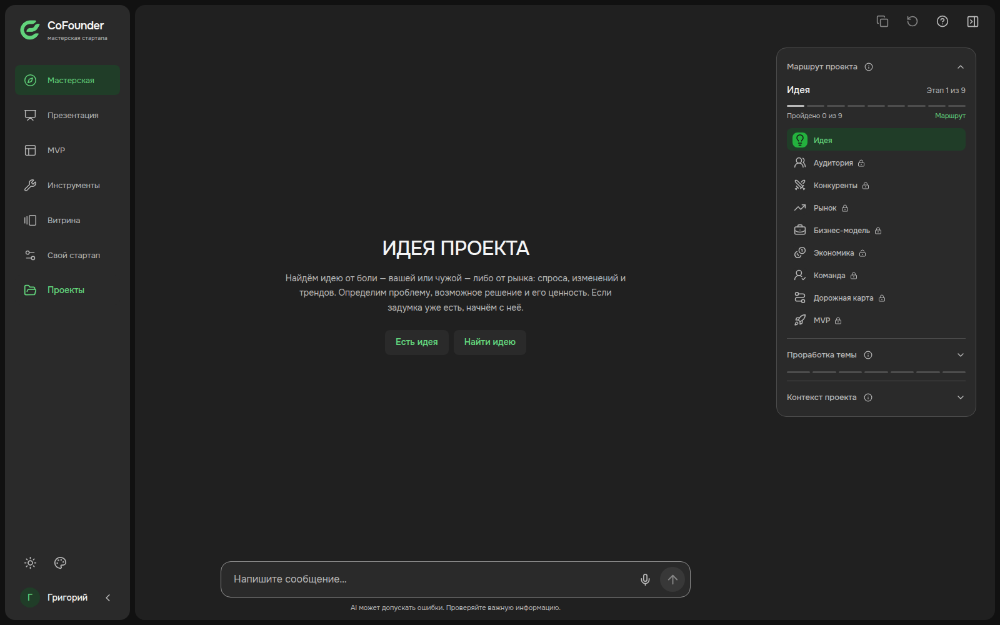
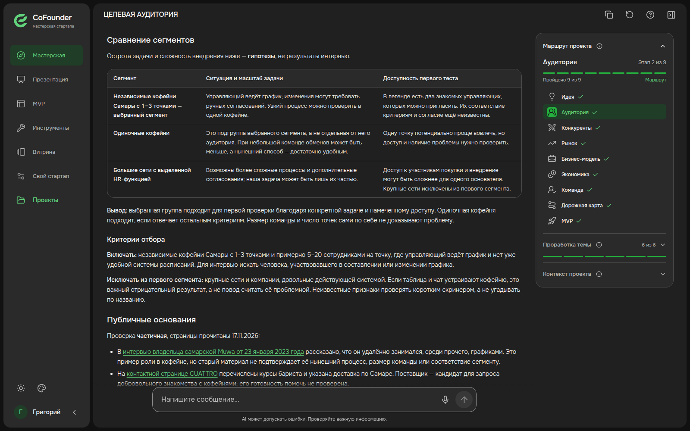
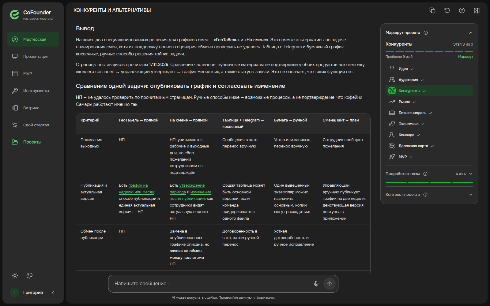
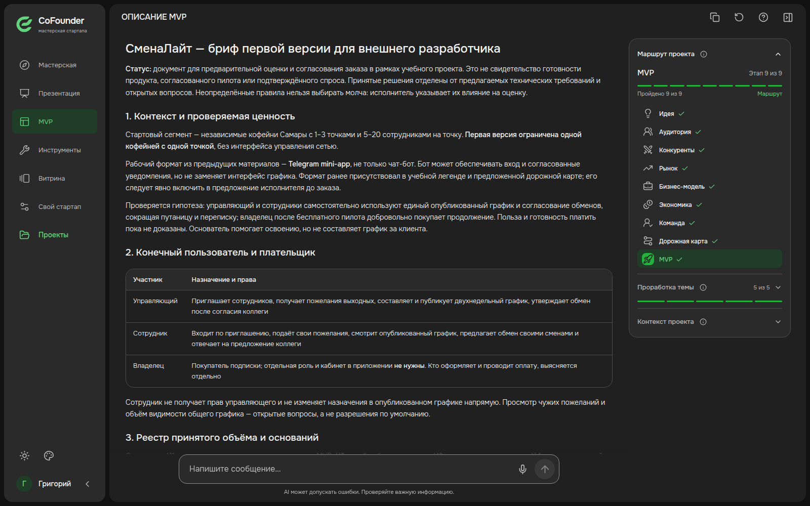
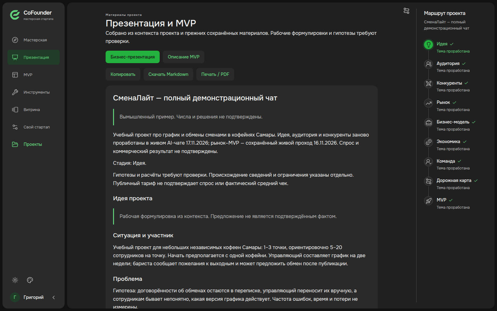
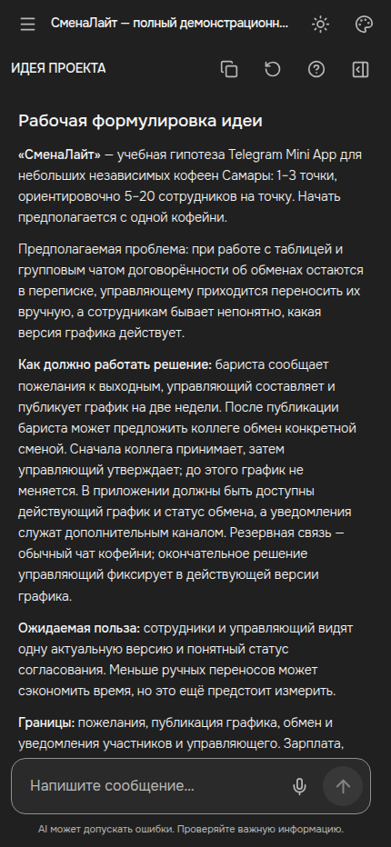
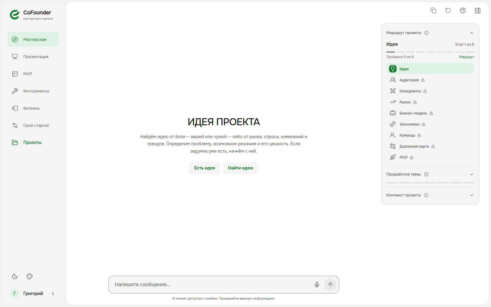
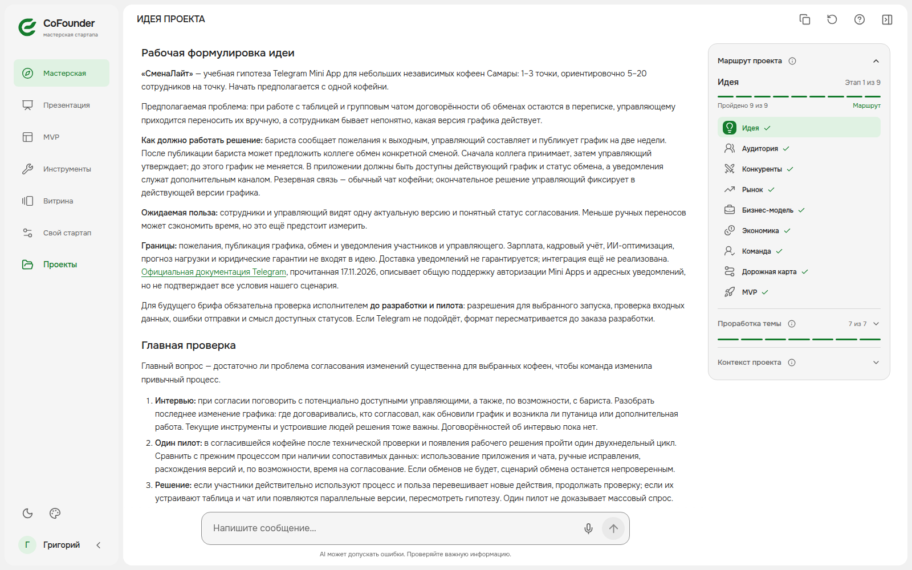

# Реальные экраны CoFounder

Снято 17 ноября 2026 года в текущем локальном приложении. Основная подборка — семь экранов в тёмной теме; в конце оставлены два светлых для сравнения. Все desktop-кадры — 1600 × 1000 CSS px, мобильный — 430 × 932. Палитра «Сбер». Изображения сохранены без дорисовки и замены текста.

[Назад к обзору](../../README.md) · [Презентация PDF](../presentation/CoFounder-Govorov-2026-11-17.pdf)

## Начало работы

Новый проект: сформулировать свою идею или начать поиск. Чат занимает основную рабочую область; маршрут остаётся справа.

## Идея «СменаЛайт»

Сохранённый ответ по учебному проекту: проблема, сценарий решения, границы и следующий способ проверки гипотезы.

## Выбор аудитории

Сравнение сегментов, критерии первого теста и ссылки на публичные основания. Предположения обозначены в самом ответе.

## Конкуренты · тёмная тема

Сравнение одной задачи по прочитанным публичным страницам. Непроверенные возможности не объявлены отсутствующими.

## Бриф для разработки

Начало сохранённого подробного брифа: контекст, роли, права и решения. Разработка самого MVP остаётся внешней задачей.

## Материалы проекта

Рабочие формулировки собираются в разделе «Презентация и MVP». Доступны копирование, Markdown и печать / PDF.

## Интерфейс на телефоне

Та же сохранённая идея в окне 430 × 932 CSS px. Меню и панель проекта доступны отдельными кнопками.

## Светлая тема · начало работы

Альтернативное оформление того же стартового экрана. Структура и доступные действия сохраняются.

## Светлая тема · идея

Та же сохранённая идея «СменаЛайт» в светлом оформлении — для сравнения с основной тёмной темой.

## Происхождение и границы

- Стартовый экран снят с нового пустого проекта, созданного штатной функцией приложения. Остальные кадры — из сохранённого workspace «СменаЛайт — полный демонстрационный чат». Текст ответов и оценки при съёмке не менялись.
- «СменаЛайт» — учебная гипотеза, а не действующий клиент или внедрённая система. Рынок → бриф пройдены 16 ноября на Sol/Luna после заранее заполненных первых трёх тем. 17 ноября идея, аудитория и конкуренты пройдены отдельно через AI-чат на Terra/Luna. Сохранённые шесть последующих этапов не перегенерировались.
- Отметка 9/9 отражает сохранённые вехи этих проходов; это не один непрерывный приёмочный прогон всех этапов на текущей модели. Оценки темы отражают покрытие критериев и могут требовать проверки.
- Публичные страницы в ответах действительно читались во время сохранённого учебного прохода. Указанные на экранах гипотезы не стали подтверждёнными продажами, интервью, пилотом или измеренной экономией времени.
- Для съёмки использованы отдельные браузерные контексты. Отправка новых запросов к AI заблокирована; платных вызовов при подготовке снимков не было. Полный workspace, request snapshots и журнал расходов в репозиторий не включены.
- PDF — экспорт существующей презентации к встрече 17 ноября. Он сохраняет формулировки и состояние проверки на момент подготовки выступления; свежие скриншоты здесь показывают текущий интерфейс.
